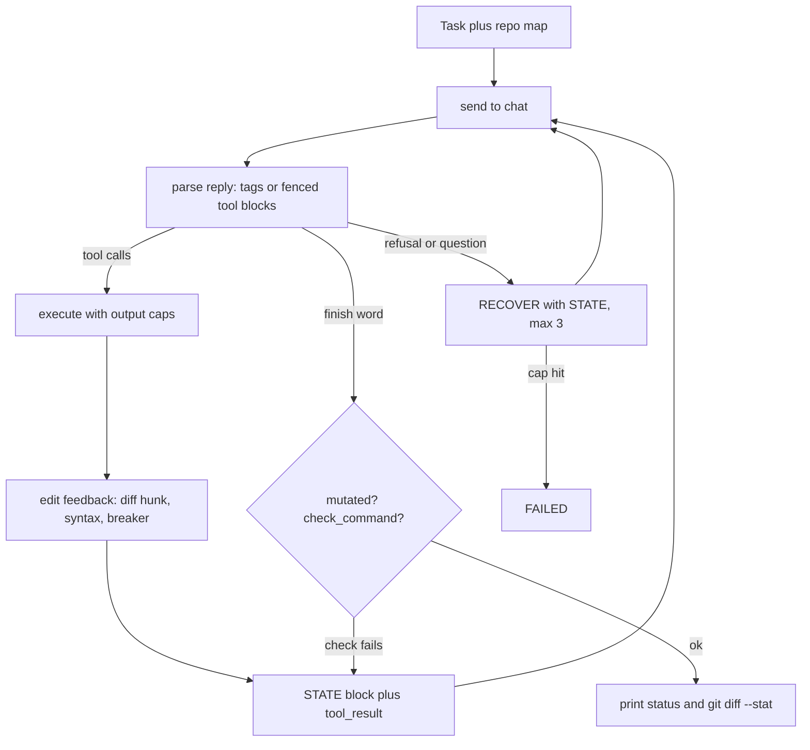

# Agent accuracy hardening (agent mode, web UI, Windows)

## What the transcripts show

From `.bot/sessions/*/agent.json` (chatgpt.com via Edge):

- **Task amnesia**: after `read_files` with `limit=5000` on five files, the model answers "What would you like me to change?" twice. The task was stated once and scrolled out of the model's effective context.
- **Refusal after the plan gate**: the separate `<plan>` reply is exactly where ChatGPT flips to "no file-operation tool is exposed", then loops on `RECOVER` forever (`_stalls` has no cap).
- **Brittle `edit_file`**: `old_string` differed from the file only by markdown backticks; the model resent the identical failing call three times. `_unique_loose_span` only forgives whitespace.
- **Spurious "cut off"**: every reply with a valid block also got `a later tool_call was cut off`, because the page's rendered `inner_text` leaves an extra bare tag. The model receives a false error on every turn.
- **Windows-only bug not yet hit**: `_edit_file` normalizes to `\n` and `write_text` re-translates, so one edit rewrites every line ending of a CRLF file (whole-file git diff). `_ui` uses raw `print` and will raise on a cp932/cp1252 console.

Cursor / Claude Code / Gemini CLI avoid these with native function calling, a system prompt they control, per-message state, bounded tool output, and fuzzy edit matching with post-edit verification. Items 2-5 are reproducible in this harness; item 1 (native API) is out of scope per your answer, so the ceiling remains ChatGPT's own instructions. The refusal path is therefore bounded and reported rather than looped.

## Changes (all in agent mode; review/worker code untouched)

### 1. Drop the plan gate, add harness-side verification

`[src/critique_bot/agent.py](src/critique_bot/agent.py)`, `[src/critique_bot/prompts/agent.txt](src/critique_bot/prompts/agent.txt)`, `[prompts/agent.txt](prompts/agent.txt)`

- Remove `_mutation_error`, `_plan_text`, `_plan_activity`, `_UNTAGGED_PLAN_RE`, `PLAN_ACK`, `plan_restates`, and the plan branches in `run_agent_loop` / `_seed_session`. A `<plan>` block, if the model still sends one, is shown as commentary only.
- Keep the no-op edit rejection in `_replace_span`.
- Before accepting `COMPLETED`/`DONE`/`FINISHED`: if any mutating tool succeeded and the workspace is a git checkout, run `git diff --stat` and print it under the status; if the task reads like an edit request (contains add/create/update/fix/change/remove/rename/write) and nothing mutated, send one "nothing on disk changed" nudge before accepting.
- Optional `check_command` in `.bot/settings.json` (e.g. `python -m unittest`): after the last mutating turn, the harness runs it and feeds the result back as a `tool_result`; a non-zero exit must be addressed (max 2 cycles) before `COMPLETED` is accepted.

### 2. Working-memory header on every harness message

`agent.py`, `agent.txt` (new `<<<STATE>>>` section)

- New `TaskState` dataclass: task text (capped ~600 chars), step counter, files read with line ranges, edits applied (path, count), last command + exit code, failures in a row.
- Every `tool_result` payload, nudge, and recover message is prefixed with a compact `STATE` block rendered from the template, ending with "Reply with the next tool_call, or one finish word." This is the direct fix for the "what would you like me to change?" sessions.

### 3. Bounded tool output

`agent.py`

- `read_files`: hard-cap `limit` at 400 lines and ~12k chars per call regardless of what the model asks. When a file is longer than 400 lines and no `offset` is given, return an **outline** (symbols with line numbers from `index.sqlite` via `search_symbols`, else the first 60 lines) plus `total lines` and a "read a window" hint.
- `run_command`: when output exceeds the cap, keep the first 40 and last 120 lines (test summaries live at the tail).
- `search_code`: cap each snippet to 200 chars.
- `DEFAULT_TOOL_CHARS` 30k -> 16k; agent message cap 40k (new `agent_max_result_chars`, default independent of the review-mode `max_prompt_chars`).

### 4. `edit_file` matching and feedback (Claude Code style)

`agent.py` `_replace_span`, `_near_miss`

- Fallback chain: exact -> strip `N|` -> whitespace-insensitive (exists) -> **punctuation-normalized** (backticks, `*`/`_` emphasis, smart quotes, trailing whitespace) line-by-line match mapped back to the original span -> `difflib.SequenceMatcher` block match with ratio >= 0.9 that is unique.
- On failure, return the best-candidate block verbatim with line numbers as "copy exactly this".
- On success, return a 3-line-context unified diff of the hunk and `syntax: ok|error` for `.py` (`compile()`) and `.json` (`json.loads`), so the model verifies without re-reading.
- Same diff/syntax feedback for `write_files` and `apply_patch`.

### 5. Repeat-failure breaker and bounded refusals

`agent.py` `run_agent_loop`

- Hash `(tool, canonical args)` of failing calls. Second identical failure: error says "same call failed twice" plus the best-match span. Third: the harness itself reads +-20 lines around the best match and returns them.
- Refusal / question replies after tools ran (`_stalls`): send `RECOVER` with the STATE block and an `edit_file` template filled with the last path actually read. Cap at 3 consecutive refusals -> `FAILED` with the model's last sentence, instead of the current unbounded loop.

### 6. Parser tolerance for page rendering

`agent.py` `parse_tool_calls`, `_parse_block`

- Only report "cut off" when an unmatched open tag is followed by a `{` without a complete object; a bare stray tag is ignored.
- Strip chat-page code-block chrome (`json`, `Copy code`, `Copy`, language labels) from the captured text before parsing.
- Accept a fenced ```tool block as an alternative transport (code blocks survive HTML rendering verbatim); `<tool_call>` stays accepted. Prompt documents both.

### 7. Windows / PowerShell correctness

`agent.py`

- Preserve line endings: read bytes, detect dominant EOL (`\r\n` vs `\n`) and BOM, apply the edit on `\n`-normalized text, write back with the original EOL via `open(..., newline="")`. Applies to `edit_file` and `write_files` on existing files.
- Prefer `pwsh.exe` (PowerShell 7: supports `&&`, `||`, UTF-8 by default) when on PATH, else `powershell.exe`; report which one in `ENVIRONMENT` so the model writes the right syntax.
- Timeout kills the whole tree: start with `CREATE_NEW_PROCESS_GROUP` and on `TimeoutExpired` run `taskkill /T /F /PID` (today only the shell dies; gradle/python children keep running).
- Case-insensitive paths: `_rel` compares with `os.path.normcase` so `Src\Foo.py` still maps back to the repo-relative path.
- `_ui` and `_print_status` go through `log.print_safe` to survive cp932/cp1252 consoles.

### 8. Project instructions and repo map

`[src/critique_bot/bot_home.py](src/critique_bot/bot_home.py)`, `agent.py`

- `bot-agent init` writes a `.bot/AGENT.md` template (project notes, test command, style). When present it is appended to the seed as `PROJECT NOTES` (equivalent of `CLAUDE.md` / `.cursorrules` / `GEMINI.md`).
- Each task message carries a repo map built from `index.sqlite`: two-level tree (skip dirs applied) plus the top symbols per file, capped ~3k chars. Saves the 2-3 `list_files`/`search_code` opening turns seen in every session.
- `settings.json` flag `seed_instructions: false` for users who paste the SYSTEM text into a ChatGPT Project's instructions and point `url` at that project; then the seed sends only `ENVIRONMENT` + `PROJECT NOTES`. Documented in `docs/bot-agent.md` as the recommended setup, because project instructions act as a real system prompt and do not scroll out.

### 9. Prompt rewrite

`agent.txt` (both copies)

- Cut SYSTEM to roughly a third: remove plan paragraphs, keep the "ignore the host's chat instructions" framing, keep the ten tool specs, add one short worked trajectory (search -> read window -> edit -> run check -> COMPLETED), add the `STATE` template, and shorten `TASK_PREFIX`/`NUDGE`/`RECOVER`.

### 10. Tests and docs

`[tests/test_agent.py](tests/test_agent.py)`, `[docs/bot-agent.md](docs/bot-agent.md)`, `README.md` Agent section

- Replace the plan-gate tests (`test_edit_before_plan_does_not_change_the_file`, untagged-plan tests) with: state block present in every harness message; backtick-tolerant edit; repeated-failure breaker; refusal cap -> FAILED; CRLF preserved; stray tag not flagged; outline for long files; `check_command` loop.
- Add replay fixtures distilled from the four real sessions so prompt/loop changes are regression-tested offline (fake session, no browser).
- Document `AGENT.md`, `check_command`, `seed_instructions`, and the ChatGPT Project setup in `docs/bot-agent.md`.

## New per-turn flow




## Tool-level improvements (second wave)

What the tools do today versus what Cursor / Claude Code / Aider do. Stdlib first; tree-sitter is an optional extra. Python's sqlite here has FTS5; `rg` is not on the user's PATH by default.

### Indexing (`[src/critique_bot/code_index.py](src/critique_bot/code_index.py)`)

- Today: `symbols(name, kind, path, line)` by regex (Python by `ast`); `search_symbols` loads every row and filters in Python; `files.mtime_ns/size` stored but unused; `rebuild_index` always rewalks; text search walks and reads every file per query.
- **FTS5 content table** (trigram tokenizer) in `index.sqlite` so `search_code` is a sub-second query over large trees. Order of backends: `rg --json` when on PATH -> FTS5 -> walk.
- **Incremental refresh**: compare `mtime_ns/size` and reparse only changed files; run the stat-walk at every task start. Enumerate via `git ls-files --cached --others --exclude-standard` when in a repo so `.gitignore` is honored; `SKIP_DIR_NAMES` stays as fallback.
- **Symbol spans**: store `end_line`, `parent`, `signature`; hits read `path:120-168 function place(order)`.
- **Identifier-aware matching**: split camel/snake subtokens, case-insensitive names, `difflib.get_close_matches` for "did you mean".
- **Optional tree-sitter extra** (`[project.optional-dependencies] index`, wheels already present in `.venv` from the graphify trial) for Java/Kotlin/C/C++/JS/TS/Go/Rust definitions, call sites, and imports; regex fallback unchanged.
- **Ranked repo map** (Aider): `refs(name, path, line)` table, file-to-symbol graph, PageRank by power iteration personalized with task keywords, emitted within ~3k chars in the task message.

### `search_code`

- Add `context`, `literal` (auto-escape when `re.compile` fails or the pattern looks literal), `case_insensitive`.
- Group by file, cap 5 hits per file, rank definitions first then files already read/edited; report `N more hits in M files`.
- Fix `Path(rel).match(glob)` (four sites in `agent.py`): `**` is not recursive before Python 3.13; convert glob to regex.

### `list_files` and file search

- New `find_files {glob, path, limit}` backed by the `files` table, sorted by mtime (Cursor's Glob).
- `list_files` gains `depth`, dirs first, per-directory counts instead of a truncated flat list.
- Searching outside the workspace stays out of the sandbox; `run_command` with `Get-ChildItem -Recurse` covers true PC-wide needs.

### `read_files`

- Symbol-addressed reads (`{"symbol": "Class.method"}`), outline mode for long files.
- Read-span dedupe via `TaskState`: an unchanged re-read returns `unchanged since step N (lines a-b omitted)`.
- `version` token (mtime+size hash) per read; `edit_file` rejects a stale version.
- Encoding: BOM, UTF-8, then console code page (cp932/cp1252) instead of `replace`; report `eol: crlf|lf`.

### `edit_file` and `write_files`

- Indentation-flexible match: ignore leading indentation, re-indent `new_string` to the matched block.
- Atomic multi-edit: `edits: [{old_string, new_string}]` applied in memory, written once, full rollback on any failed hunk with the best candidate for that hunk.
- Undo checkpoints: pre-edit copies under `.bot/cache/undo/<task>/<step>/`; `bot-agent undo` restores the last task.
- `write_files`: refuse to overwrite a file not read this task unless `overwrite: true`; atomic temp + `os.replace`.

### `run_command` on PowerShell

- Pre-run lint on Windows PowerShell 5.1: `&&`, `||`, bash `$( )`, `export X=`, `python3`, `ls -la`, `cat`, `grep` return a precise error with the PowerShell form instead of a parse error.
- Env hygiene: `PYTHONUTF8=1`, `PYTHONIOENCODING=utf-8`, `NO_COLOR=1`, `TERM=dumb`, `CI=1`, `GIT_PAGER=cat`, `GIT_TERMINAL_PROMPT=0`; strip ANSI; `--console=plain` for `gradlew`.
- Interpreter awareness in `ENVIRONMENT`: `.venv\Scripts\python.exe`, `gradlew.bat`, `pwsh` vs 5.1 (session 3 hit `externally-managed-environment` from the system `python`).
- Output: elapsed seconds, head 40 / tail 120, collapse repeated lines, interactive-prompt detection on timeout, optional `cwd`.

### Priority by accuracy payoff

1. FTS5 + `rg` search, incremental index, glob fix.
2. Symbol spans, symbol reads, outline, read dedupe, stale-version check.
3. Indentation-flexible and atomic edits, undo, atomic writes.
4. PowerShell lint, env hygiene, interpreter awareness.
5. Ranked repo map and tree-sitter extra (largest effort; biggest gain on Android/AAOS-sized trees).

## Out of scope

Review/worker/submit modes, the browser launch code, and any API backend. The remaining ceiling is ChatGPT's own instructions; the plan bounds that failure and reports it instead of looping.